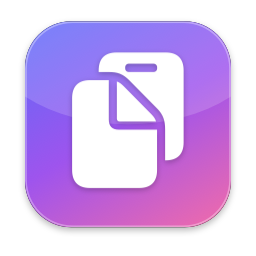
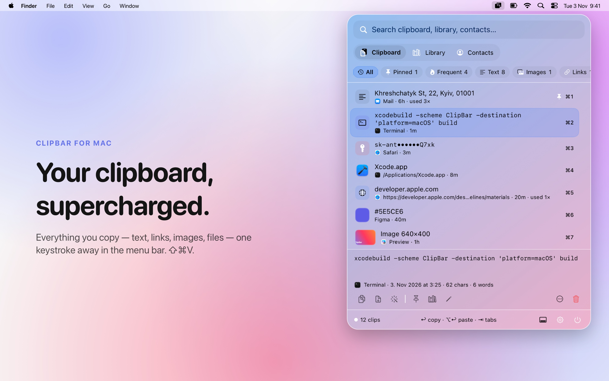
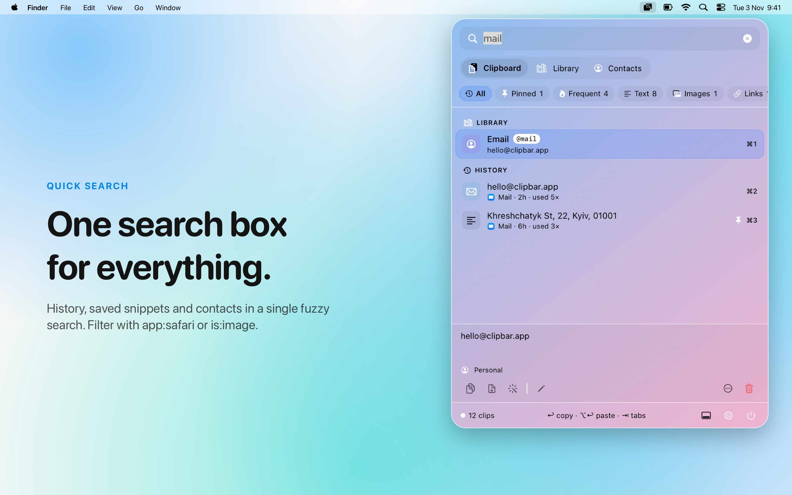
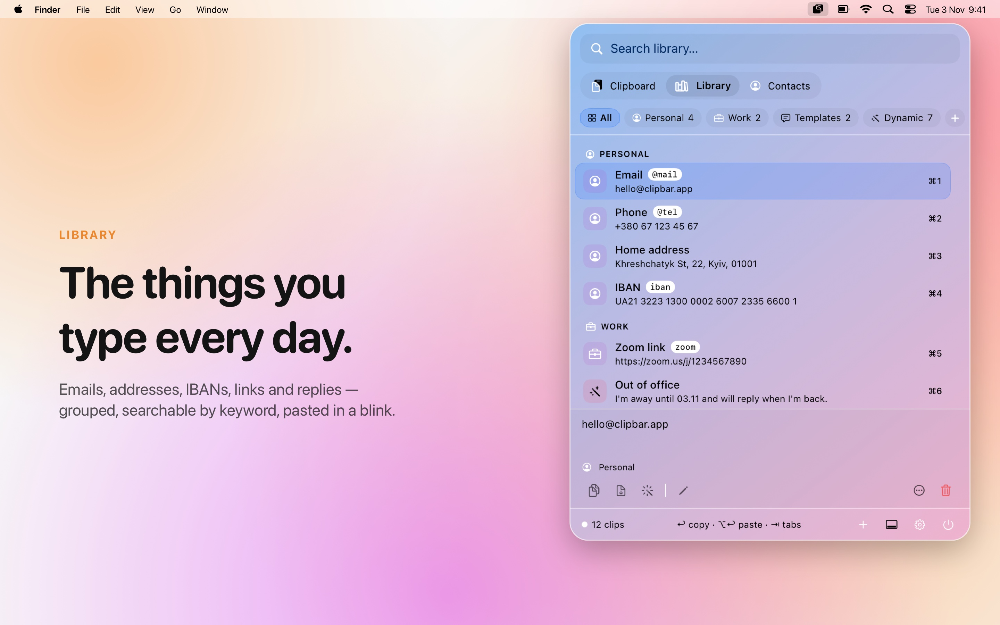
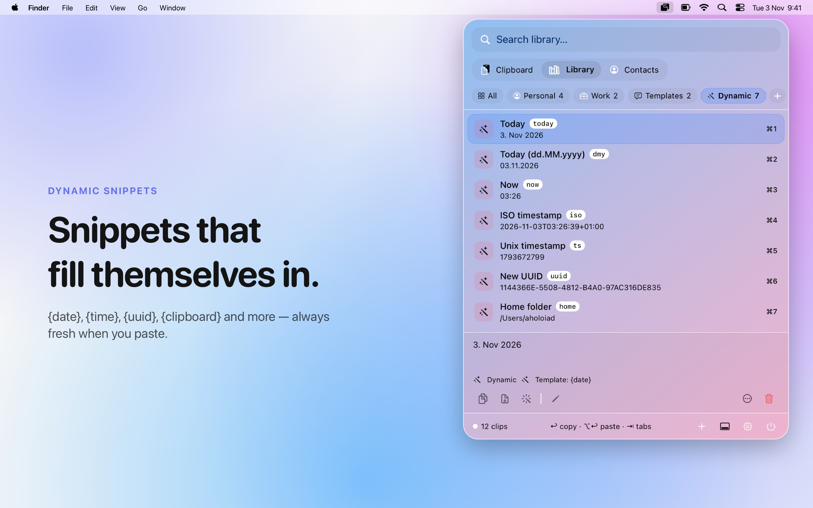
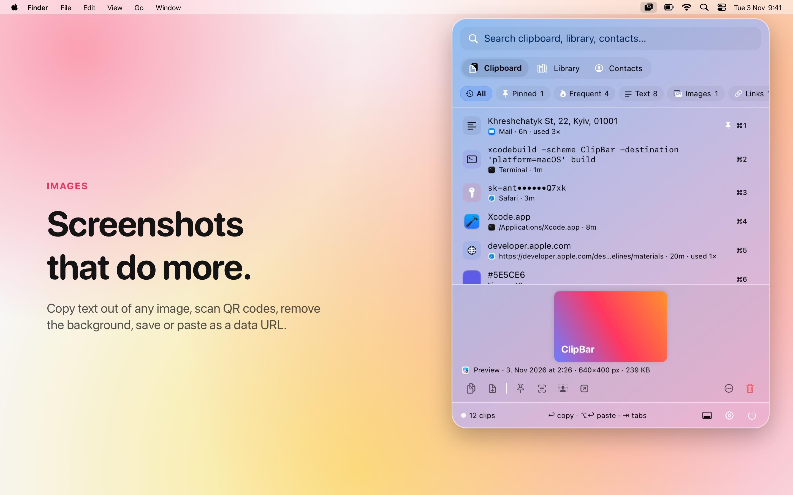
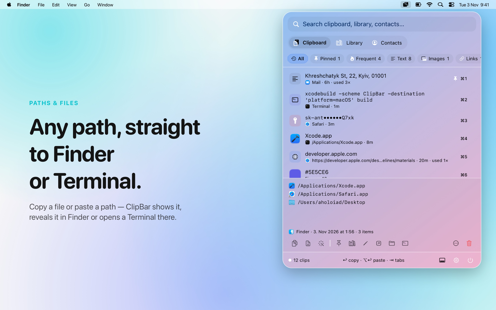
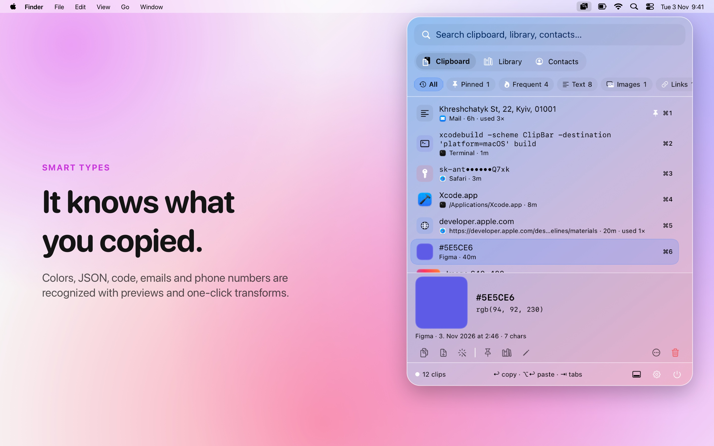
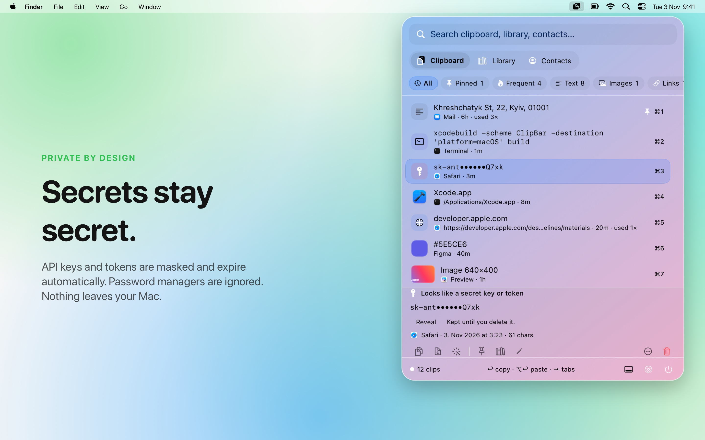
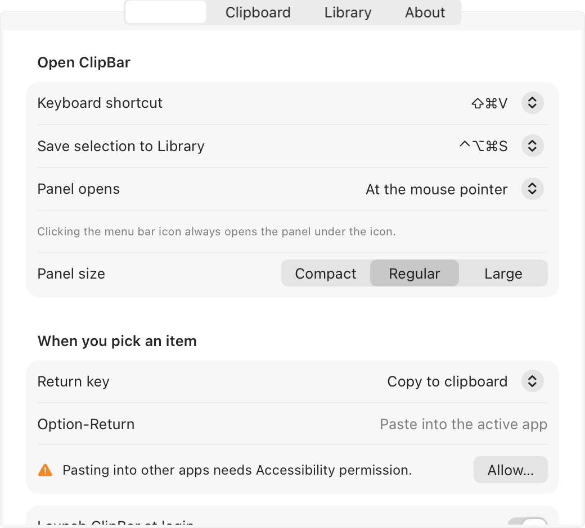

<p align="center">
  
</p>

<h1 align="center">ClipBar</h1>

<p align="center"><b>Your clipboard, supercharged.</b><br>
A Liquid Glass clipboard manager and "everything you paste" library that lives in the Mac menu bar.</p>

<p align="center"></p>

Press **⇧⌘V** (or click the menu bar icon) and a glass panel drops down under the icon. Everything you copied, the snippets you type every day and your contacts are one search away. Hit ↩ to copy, ⌥↩ to paste straight into the app you were in.

## Why ClipBar

- **Never lose a copy.** Text, links, files, images, colors and code are all kept, with the app they came from.
- **One search for everything.** History, your Library and Contacts in a single fuzzy search box.
- **Stop retyping.** Emails, addresses, IBANs, replies and dynamic snippets like `{date}` and `{uuid}`.
- **Do more with what you copied.** OCR, QR codes, background removal, JSON formatting, case changes, a calculator and more, right before you paste.
- **Private.** Everything stays on your Mac. Passwords are never stored, API keys are masked and expire.
- **Native.** SwiftUI, Liquid Glass, keyboard-first, tiny footprint.

| | |
| --- | --- |
|  |  |
|  |  |
|  |  |
|  |  |

Raw panel renders are in [docs/screenshots](docs/screenshots). Launch copy and promo plan are in [docs/marketing/launch-kit.md](docs/marketing/launch-kit.md).

## What's inside

**Clipboard history**
- Keeps text, links, files (one or many), images, colors, emails, phone numbers, code and JSON, with the app each clip came from.
- Smart filters: All, Pinned, Frequent, Text, Images, Links, Files, Code, Colors, Emails & Phones.
- Passwords and other concealed content are never stored. API keys and tokens are masked and removed after 10 minutes unless pinned.
- Ignore apps (password managers are ignored by default), pause capturing, history limits and age cleanup.

**Library** — information you reuse
- Groups (Personal, Work, Templates, Dynamic, plus your own) with items that have a title, value and optional keyword such as `@mail`.
- Dynamic items: `{date}`, `{date:dd.MM.yyyy}`, `{time}`, `{iso}`, `{timestamp}`, `{uuid}`, `{clipboard}`, `{fullname}`, `{home}` and more.
- Import your own card from Contacts, export and import the Library as JSON.
- **⌃⌥⌘S** in any app saves the selected text straight into the Library.

**Contacts**
- Search the Contacts app and copy a phone, email, address or URL in one keystroke.

**Quick search**
- One field searches history, Library and Contacts at once. Filters: `app:safari`, `is:image`, `is:link`, `is:file`, `is:code`, `is:color`, `is:email`, `is:pinned`, `is:today`.

**Actions** (preview bar, right-click, or shortcuts)
- Copy, or paste straight into the app you were using (needs Accessibility permission).
- Transform before copying: UPPER/lower/Title, trim, one line, sort or dedupe lines, JSON pretty/minify/escape, URL and Base64 encode/decode, snake_case/camelCase, strip Markdown, remove tracking parameters from links, color HEX ↔ rgb(), timestamp → date, calculate `(19.99+5)*2`.
- Images: copy text from image (OCR), scan QR codes and barcodes, remove background, copy as data URL, save to Downloads.
- Make a QR code from any text or link.
- Files: open, show in Finder, open in Terminal (a file opens its folder).
- Pin, edit, add to Library, delete.

The right-click menu on the icon lists pinned clips and Library groups for mouse-only access.

## Keyboard

| Key | Action |
| --- | --- |
| ↑ ↓ | Move |
| ↩ | Copy (or paste, see Settings) |
| ⌥↩ | The other one |
| ⌘1 … ⌘9 | Pick an item |
| ⇥ / ⇧⇥ | Next / previous tab |
| ⌘P | Pin |
| ⌘L | Add to Library |
| ⌘E | Edit |
| ⌘⌫ | Delete |
| ⌘O | Open |
| ⌘R / ⌘T | Show in Finder / Open in Terminal |
| ⌘I | Toggle preview |
| ⌘N | New Library item |
| esc | Clear search, then close |

## Build and install

Requires Xcode 27 and [XcodeGen](https://github.com/yonaskolb/XcodeGen).

```bash
xcodegen generate
```

```bash
xcodebuild -scheme ClipBar -destination 'platform=macOS' -configuration Release -derivedDataPath /tmp/clipbar-dd build && rm -rf /Applications/ClipBar.app && cp -R /tmp/clipbar-dd/Build/Products/Release/ClipBar.app /Applications/ && open /Applications/ClipBar.app
```

The app is signed with the local Apple Development certificate (team `33K57T9459` in `project.yml`), so Accessibility and Contacts permissions survive rebuilds.

## Tests and checks

```bash
xcodebuild test -scheme ClipBarTests -destination 'platform=macOS'
```

Two hidden launch modes help verify the app without clicking through it:

```bash
/Applications/ClipBar.app/Contents/MacOS/ClipBar --selftest
```

```bash
/Applications/ClipBar.app/Contents/MacOS/ClipBar --snapshot ~/Desktop/ClipBarSnapshots
```

Promo images are generated from the snapshots:

```bash
swift scripts/make-promo.swift ~/Desktop/ClipBarSnapshots docs/promo
```

`--selftest` runs OCR, QR, background removal, templates and the calculator end to end. `--snapshot` renders the panel with sample data into PNGs. Both use an in-memory store and never touch your history.

## Layout

```
Sources/Core      models (SwiftData), stores, search, transforms, templates, content detection
Sources/App       app delegate, panel, pasteboard capture, settings, system integrations
Tests             unit tests for Core
docs/superpowers  design specs and plans
```

Data lives in `~/Library/Application Support/ClipBar`.
